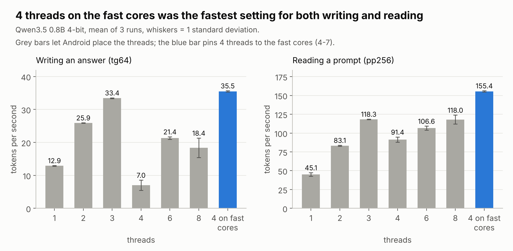
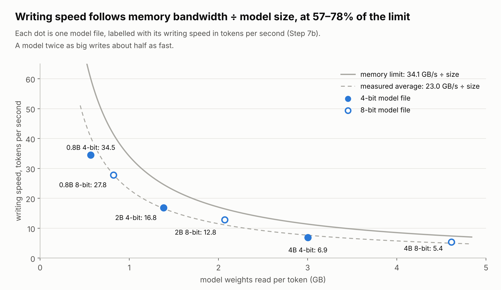
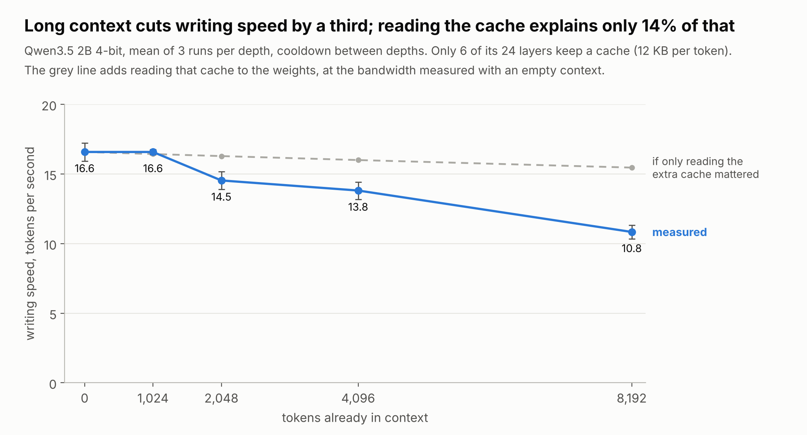
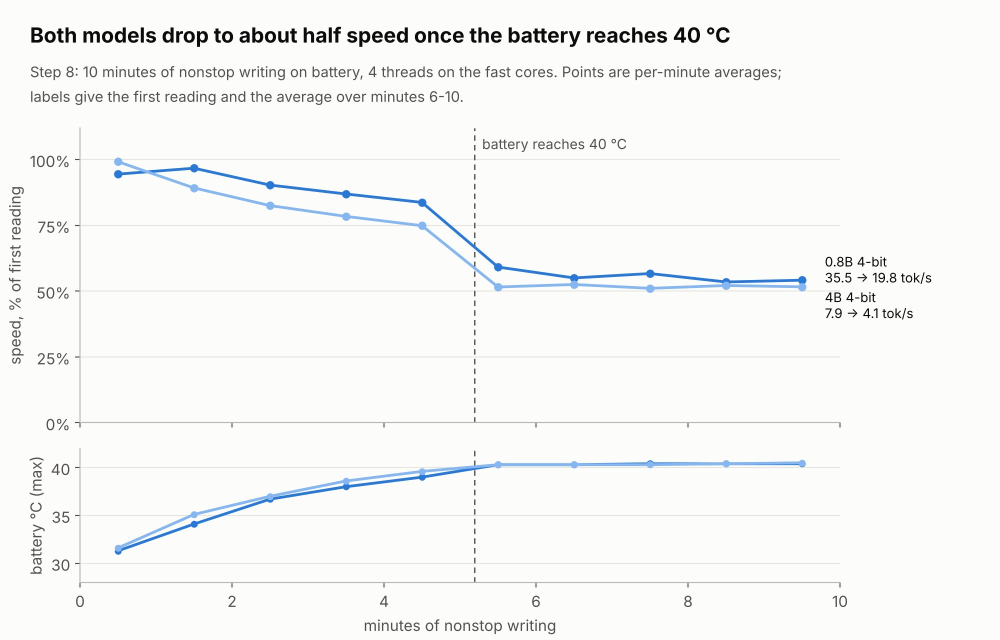
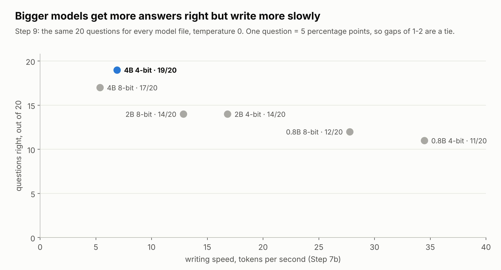

# Running AI language models on a 2021 phone: what limits the speed?

A small, fully reproducible experiment. I ran six versions of the same open AI model, offline, on a OnePlus Nord 2 (2021, 8 GB RAM) and measured how fast it writes and reads, how much a long conversation slows it down, how heat and battery change over 10 minutes, and how many test questions each version gets right.

**Short answer:** the phone writes as fast as its memory can deliver the model, and no faster. A model twice as big writes about half as fast. After about 5 minutes of nonstop work, the phone slows to roughly half speed to keep the battery near 40 °C. The best all-round choice on this phone was the 4-billion-parameter model compressed to 4-bit: 19 of 20 questions right, at about reading speed.

Every number and chart here is rebuilt from the raw files in [`results/`](results/) by one script. The full step-by-step method, written for beginners, is in [GUIDE.md](GUIDE.md).

---

## Key findings

1. **Use the 4 fast cores, not all 8.** The phone's chip has 4 fast cores and 4 slow ones. Pinning the work to the 4 fast cores was fastest, at 35.5 tokens per second. Using all 8 dropped it to 18.4, because the fast cores spend their time waiting for the slow ones.
2. **Memory bandwidth sets the writing speed.** To write each token, the phone reads the whole model from memory once. Measured speeds were 57–78% of the limit that the phone's memory speed allows. Speed × model size stayed between 19.6 and 26.6 GB/s across an eightfold range of sizes.
3. **4-bit compression speeds up writing but slows reading.** 4-bit files wrote 24–31% faster than 8-bit files of the same model, but read prompts 2–22% slower, because unpacking 4-bit numbers takes extra arithmetic.
4. **Long conversations slow it down, and the cache isn't the main reason.** With 8,192 tokens already in context, the 2B model wrote 35% slower. Only 6 of its 24 layers keep a growing cache, and reading that cache explains just 14% of the slowdown.
5. **Heat halves the speed after about 5 minutes.** When the battery reached 40 °C, the phone cut its processor speed. Both models tested then ran at 52–56% of their starting speed.
6. **Bigger models answer better, and 4-bit costs almost nothing.** Out of 20 questions, the 0.8B model got 11–12 right, 2B got 14 and 4B got 17–19. The 4-bit and 8-bit versions of each size scored within 2 questions of each other.
7. **Memory size is the hard limit.** Android leaves only about 5 GB of the phone's 8 GB free. The largest file (4B 8-bit, 4.6 GB) still ran, but a heavier test on it did not fit.

---

## Words used here

| Word | What it means |
| --- | --- |
| LLM (model) | A program that writes text by predicting the next piece, one piece at a time |
| Token | One piece of text the model reads or writes, usually part of a word |
| tok/s | Tokens per second: how fast the model works |
| 0.8B, 2B, 4B | Model size: 0.8, 2 or 4 billion stored numbers (parameters). Bigger is usually smarter but slower |
| 4-bit, 8-bit (Q4_K_M, Q8_0) | How much space each stored number gets. 4-bit files are smaller; 8-bit files stay closer to the original |
| Reading speed (pp) | How fast the model takes in your question ("prompt processing") |
| Writing speed (tg) | How fast it writes the answer ("text generation"). This is the speed you feel |
| Thread | One stream of work; 4 threads means 4 cores working at once |
| Memory bandwidth | How many gigabytes per second the chip can read from memory |
| Throttling | The phone slowing itself down so it doesn't overheat |
| Perplexity | How well a model predicts real text. Lower is better |
| Context, KV cache | Everything the model has read or written so far in a conversation, and the memory where it keeps it |

---

## Setup

| | |
| --- | --- |
| Phone | OnePlus Nord 2 (model DN2101), Android 13 (OxygenOS DN2101_11_F.59) |
| Chip | MediaTek Dimensity 1200-AI: 1 × Cortex-A78 at 3.0 GHz, 3 × A78 at 2.6 GHz, 4 × Cortex-A55 at 2.0 GHz |
| Memory | 8 GB LPDDR4X-4266 on a 64-bit bus = **34.1 GB/s** peak ([spec sheet](https://www.91mobiles.com/processor/mediatek-dimensity-1200-pdp)). "RAM expansion" turned off |
| Battery | 4,500 mAh |
| Software | [Termux](https://termux.dev) (Linux command line for Android) and [llama.cpp](https://github.com/ggml-org/llama.cpp) commit `caa8191df`, run on the CPU only |
| Models | [Qwen3.5](https://unsloth.ai/docs/models/qwen3.5.md) 0.8B, 2B and 4B, each as 4-bit (Q4_K_M) and 8-bit (Q8_0) files from [bartowski](https://huggingface.co/bartowski/Qwen_Qwen3.5-2B-GGUF) |
| Conditions | Airplane mode, on battery, screen on, no case, room at 25 °C; cooldown to 31 °C battery temperature before each test; 26–27 October 2026 |

Only one thing changes between the six files: size (0.8B, 2B, 4B) or bits (4 or 8). That way, any difference in the results comes from one of those two things.

---

## Results

### 1. Use the 4 fast cores



llama.cpp splits each step evenly across its threads and waits for all of them to finish. Unpinned, Android places the threads wherever it likes. With exactly 4 threads and exactly 4 fast cores, any background work from Android most likely pushed one thread onto a slow core or onto a shared core, and the other three waited for it at every step. That's why unpinned 4 threads collapsed to 7.0 tokens per second, with a wide spread. Pinning 4 threads to the fast cores (`-C 0xF0 --cpu-strict 1`) fixed this. All later tests use that setting.

Reading and writing also behave differently. Reading gained 35–38 tokens per second with each added core (45 → 83 → 118 → 155), because it is limited by arithmetic. Writing doubled from 1 to 2 threads, then flattened, because it is limited by memory.

### 2. Memory bandwidth sets the writing speed



To write one token, the processor must read every number in the model once. So the fastest possible writing speed is:

```
max tokens per second = memory bandwidth ÷ model size
```

| Model file | Weights read per token | Reading speed | Writing speed | Memory limit | % of limit | Speed × size |
| --- | --- | --- | --- | --- | --- | --- |
| 0.8B 4-bit | 0.57 GB | 149.8 tok/s | 34.5 tok/s | 60.0 tok/s | 57% | 19.6 GB/s |
| 0.8B 8-bit | 0.82 GB | 181.5 tok/s | 27.8 tok/s | 41.4 tok/s | 67% | 22.9 GB/s |
| 2B 4-bit | 1.39 GB | 71.4 tok/s | 16.8 tok/s | 24.6 tok/s | 68% | 23.3 GB/s |
| 2B 8-bit | 2.07 GB | 91.4 tok/s | 12.8 tok/s | 16.5 tok/s | 78% | 26.6 GB/s |
| 4B 4-bit | 3.00 GB | 26.7 tok/s | 6.9 tok/s | 11.4 tok/s | 61% | 20.7 GB/s |
| 4B 8-bit | 4.61 GB | 27.2 tok/s | 5.4 tok/s | 7.4 tok/s | 73% | 24.8 GB/s |

Speeds are the mean of 3 runs with a 512-token prompt (reading) and 128 generated tokens (writing). "Weights read per token" is the model size llama.cpp reports after loading.

If memory sets the speed, speed × size should be roughly constant, and it is: 19.6–26.6 GB/s (average 23.0 GB/s) across an eightfold range of sizes. In practice the phone reaches 57–78% of its theoretical peak.

### 3. Long context slows writing, and the cache isn't the main reason



The tests above start from an empty context. In a real conversation, the model also looks back over everything said so far, which it keeps in memory as the KV cache. This test (Step 7c in the guide) first fills the context to a set length, then measures writing speed, with a cooldown between lengths.

| Tokens already in context | 0 | 1,024 | 2,048 | 4,096 | 8,192 |
| --- | --- | --- | --- | --- | --- |
| Writing speed (tok/s) | 16.6 | 16.6 | 14.5 | 13.8 | 10.8 |
| Compared with empty context | 100% | 100% | 88% | 83% | 65% |

Qwen3.5 is a hybrid model, which limits how big that cache gets. The llama.cpp log ([`kvcache_2B_ctx8192.log`](results/kvcache_2B_ctx8192.log)) shows that only 6 of the 2B model's 24 layers keep a cache that grows with context. The other 18 keep a fixed 19 MB memory instead. At 8,192 tokens the cache is 96 MB, or 12 KB per token.

Reading those extra 96 MB at the bandwidth measured with an empty context costs about 4 ms per token, but writing slowed by 32 ms per token. So reading the cache explains only about 14% of the slowdown. The rest is most likely the arithmetic of comparing each new token with every earlier one, which grows with context and does not keep pace with memory on this CPU.

### 4. 4-bit: faster writing, slower reading

| Size | 4-bit vs 8-bit, writing | 4-bit vs 8-bit, reading | 4-bit vs 8-bit, file size |
| --- | --- | --- | --- |
| 0.8B | 1.24 × faster | 0.83 × (17% slower) | 0.69 × |
| 2B | 1.31 × faster | 0.78 × (22% slower) | 0.67 × |
| 4B | 1.29 × faster | 0.98 × (2% slower) | 0.65 × |

The 4-bit files are about a third smaller, but they write only 24–31% faster, not the 45–54% their size predicts. Unpacking 4-bit numbers adds arithmetic, and that arithmetic also makes 4-bit files slower at reading prompts, which is purely an arithmetic job.

### 5. Heat halves the speed after about 5 minutes



Two models wrote text nonstop for 10 minutes on battery. For the first 5 minutes, speed slid slowly as the battery warmed from about 30 °C to 39 °C. At 311–312 seconds the battery reached 40 °C, the phone cut its processor speed, and both models settled at about half speed. The battery then held at 40.3–40.6 °C until the end.

This is throttling. A phone can only shed so much heat, so once it reaches its limit, it slows down until it makes no more heat than it can lose. Both models heated the phone at the same rate, because both kept the 4 fast cores fully busy.

| Model | Start | Minutes 6–10 | Tokens in 10 min | Battery used | Battery per 1,000 tokens |
| --- | --- | --- | --- | --- | --- |
| 0.8B 4-bit | 35.5 tok/s | 19.8 tok/s (56%) | 11,648 | 6% | about 23 mAh |
| 4B 4-bit | 7.9 tok/s | 4.1 tok/s (52%) | 2,560 | 6% | about 105 mAh |

The bigger model uses about 4.5 times more battery for the same amount of text. The battery figures are rough (about ±17%), because Android reports the battery level in whole 1% steps.

### 6. Bigger models answer better



Every model file answered the same 20 short questions (5 arithmetic, 5 facts, 5 logic, 4 language, 1 science) at temperature 0, so the same file always gives the same answer. Answers were marked automatically against a list of accepted answers.

- **Size matters most:** 0.8B got 11–12 right, 2B got 14 and 4B got 17–19.
- **Facts were easy:** every model got all 5 fact questions right.
- **Arithmetic and logic separated the models:** only 4B got all 5 arithmetic questions right.
- **One question beat every model:** "If today is Monday, what day will it be 10 days from now?" (Thursday).
- **This is a small test:** one question is 5 percentage points, so gaps of 1–2 questions count as a tie.

Perplexity measures the same thing more finely. It shows how well each model predicts real Wikipedia text (20 chunks of 512 tokens from WikiText-2; lower is better):

| Size | 4-bit | 8-bit | 4-bit worse by |
| --- | --- | --- | --- |
| 0.8B | 19.59 | 19.07 | 2.7% |
| 2B | 13.78 | 13.52 | 1.9% |
| 4B | 10.26 | did not fit in memory | |

Compressing to 4-bit made the models 2–3% worse at predicting text. Going from 0.8B to 4B made them about 48% better (19.59 → 10.26 for the 4-bit files). In every one of the 20 chunks, the 4-bit file scored slightly worse than the 8-bit file of the same size, so this small gap is real.

### 7. Memory size is the hard limit

The phone reports 7.7 GB of usable memory. Android and its background apps take about 2.7 GB of that, so only about 5 GB is free, even right after a restart. The 4B 8-bit file (4.6 GB) still ran in the speed and question tests. The perplexity test needs extra working memory on top of the model, though, and Android stopped it both times.

---

## What this means in practice

- **For the best answers:** use the 4B 4-bit model. It got 19 of 20 right and writes at about reading speed (7 tokens per second), but it takes about 19 seconds to read a 512-token prompt.
- **For speed:** use the 2B 4-bit model. It writes more than twice as fast (17 tokens per second) but makes more mistakes.
- **Prefer 4-bit files on this phone.** The 8-bit files write more slowly and scored no better in this test.
- **Expect long jobs to run at about half speed** once the phone warms up.
- **Keep conversations short when speed matters:** with 8,192 tokens of context, the 2B model writes about a third slower.

---

## Limitations

- **One phone, one unit:** another Nord 2 may run a little faster or slower.
- **Battery temperature stands in for chip temperature:** Termux can read the battery's sensor, not the processor's.
- **20 questions is a small test:** treat score differences of 1–2 as a tie.
- **CPU only:** llama.cpp in Termux has no GPU or NPU acceleration here, so apps that use the GPU may run faster.
- **One model family:** other model families may behave a little differently, although the bandwidth limit applies to all of them.
- **Long context tested on one model:** only the 2B 4-bit file, up to 8,192 tokens.

---

## Reproduce it

1. Follow [GUIDE.md](GUIDE.md) on any Android phone. It goes from installing Termux to the last test, in plain steps.
2. To rebuild the charts and tables from the raw results:

   ```bash
   pip install -r requirements.txt
   python analysis/make_figures.py
   ```

   This rewrites `figures/*.png` and `analysis/summary.csv` and prints the key numbers.

---

## What's in this repository

```text
android-llm-bench/
├── README.md              this write-up
├── GUIDE.md               step-by-step method for beginners
├── results/               raw output from the phone, unedited
│   ├── env.txt            phone, Android, RAM, cores, llama.cpp commit
│   ├── threads*.csv       Step 7a: thread sweep
│   ├── speed_*.csv        Step 7b: reading and writing speed per model file
│   ├── depth_2B_*.csv     Step 7c: writing speed with 0 to 8,192 tokens in context
│   ├── kvcache_2B_ctx8192.log  llama.cpp log with the cache size and layer layout
│   ├── sustained_*.csv    Step 8: 10-minute heat and battery runs
│   ├── quality_*.csv      Step 9: answers to the 20 questions
│   └── ppl_*.txt          Step 9: perplexity logs
├── scripts/               the scripts that ran on the phone
├── analysis/
│   ├── make_figures.py    rebuilds every chart and table from results/
│   └── summary.csv        one row per model file
└── figures/               the charts in this README
```

The `ppl_Qwen_Qwen3.5-4B-Q8_0.txt` log is kept even though it stops early, as evidence of the out-of-memory result. In the `sustained_*.csv` files, ignore the `current_ua` column: it mixes two units and is read in the short idle pause between rounds.

---

## Next

- **iPhone X (Phase 2):** the same tests on an iPhone X (2017, 3 GB RAM), published in a separate repository for iOS devices. Running the same model files through the same engine on a second chip tests whether the bandwidth rule predicts its speed too.
- **More Android phones** can be added to this repository later.

---

## Credits and licence

- Models: [Qwen3.5](https://huggingface.co/Qwen) by the Qwen team (Apache 2.0); GGUF files by [bartowski](https://huggingface.co/bartowski).
- Engine: [llama.cpp](https://github.com/ggml-org/llama.cpp) (MIT).
- Test text for perplexity: WikiText-2 (CC BY-SA 3.0).

Code in this repository (`scripts/`, `analysis/`) is under the [MIT License](LICENSE). The results, figures and written guides are under [CC BY 4.0](LICENSE-CONTENT.md): you can reuse them with credit.

If you use this work, please cite it as described in [CITATION.cff](CITATION.cff).
